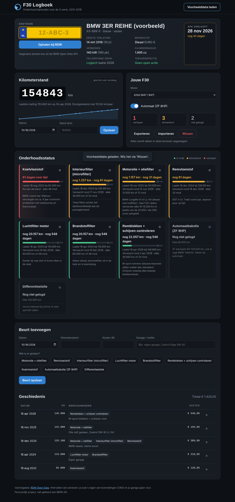

# F30 Logboek

Een onderhoudslogboek voor de BMW F30 (3-serie, 2012–2019). Vul je kenteken in en de site haalt live je APK-datum, bouwjaar, vermogen en tellerstand-oordeel op bij de RDW. Daarnaast log je je beurten en kilometerstanden, en rekent de site per onderdeel uit wanneer het volgende onderhoud nodig is.

**[Live demo →](https://Roemang.github.io/f30-logboek/)** — klik op *Voorbeelddata laden* om het met gevulde data te zien.



## Functies

- **RDW Open Data-koppeling**: APK-vervaldatum met aftelling, eerste toelating, brandstof en Euro-klasse, vermogen (kW en pk), tellerstand-oordeel en openstaande terugroepacties.
- **Kilometerprognose**: op basis van je ingevoerde standen schat de site je kilometerstand van vandaag, met een grafiekje van je rijgedrag.
- **Onderhoudsstatus per onderdeel**: olie, remvloeistof, filters, bougies, remmen, koelvloeistof, automaatbak en differentieel. Elk onderdeel kijkt naar km én tijd, en wat het eerst komt telt.
- **F30-specifiek**: intervallen per motor (benzine, diesel of 330e), automaat aan/uit, en tips per onderdeel. Intervallen zijn per onderdeel aan te passen.
- **Motorherkenning**: de site raadt je motor aan de hand van vermogen en brandstof uit de RDW.
- **Privé**: alles blijft in je eigen browser (localStorage). Exporteren en importeren als JSON.

## Techniek

- Puur HTML, CSS en JavaScript (ES-modules), geen framework en geen build-stap.
- Externe API: [RDW Open Data](https://opendata.rdw.nl) (Socrata), datasets `m9d7-ebf2` (gekentekende voertuigen) en `8ys7-d773` (brandstof). Gratis, zonder API-sleutel, met CORS.
- Responsive tot 360px breed, toetsenbord-toegankelijk.

```
index.html
css/style.css
js/
  app.js        UI en rendering
  rdw.js        RDW API-client
  calc.js       km-prognose en onderhoudsstatus
  intervals.js  F30-motoren en onderhoudsintervallen
  storage.js    opslaan, exporteren, importeren
```

## Werken in Visual Studio Code

Open de map met **File → Open Folder**. VS Code vraagt dan of je de aanbevolen extensies wilt installeren; kies *Install All*.

| Wat | Hoe |
|---|---|
| Site bekijken | Klik rechtsonder op **Go Live** (Live Server). De pagina ververst vanzelf bij elke wijziging. |
| Debuggen | Start eerst Go Live, druk dan op **F5** en kies *Debug in Chrome*. Breakpoints in `js/` werken dan gewoon. |
| Code netjes maken | Gebeurt automatisch bij opslaan (Prettier). |
| Fouten vinden | Eenmalig `npm install` in de terminal, daarna toont ESLint waarschuwingen in de editor. Of `npm run lint`. |
| Zonder Live Server | **Terminal → Run Task → Server starten (Python)** en open `http://localhost:5500`. |

Let op: dubbelklikken op `index.html` werkt niet, want ES-modules hebben een server nodig.

## Waarom geen live kilometerstand van BMW?

BMW blokkeert sinds september 2025 apps van derden op de MyBMW-servers. De officiële route is BMW CarData, maar die vraagt OAuth met een eigen server, heeft een limiet van 50 aanvragen per dag en werkt niet bij F30's met een uitgeschakelde 3G-module. Voor een statische site is de RDW daarom de betrouwbaardere bron, met handmatige kilometerstanden als aanvulling.

## Disclaimer

De onderhoudsintervallen zijn adviezen. De servicemeldingen van je eigen auto (CBS) en je garage gaan altijd voor. Dit is een persoonlijk project en niet gelieerd aan BMW AG.

## Licentie

MIT
